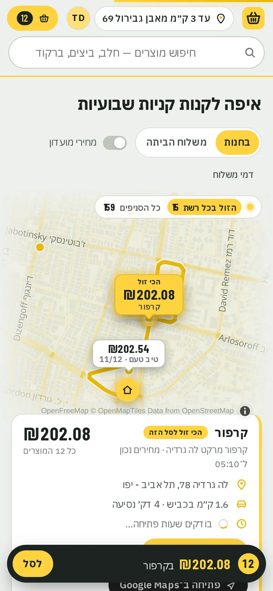
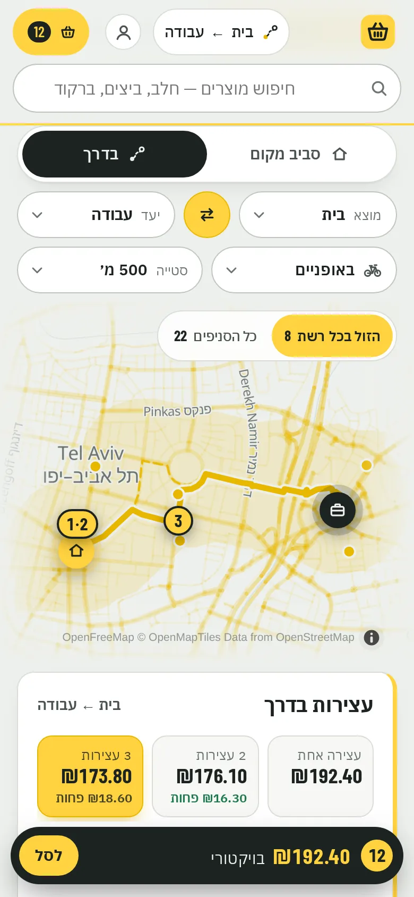

# Sal-Kal · סל קל

**What your cart costs, at every supermarket near you.** Sal-Kal prices a whole shopping cart at every Israeli
supermarket chain within your chosen distance, or along your way to work, and shows where it costs least.
Live at **[sal-kal.com](https://sal-kal.com)**.

**Not for profit, and open source.** Sal-Kal began as a personal project, built for one household's own shopping,
not as a business. It is free for shoppers, has no ads, and no retailer pays for placement. All the code is in this
repository under the [MIT license](LICENSE).

<p align="center">
&nbsp;&nbsp;</p>

## Where the prices come from
Section 30 of Israel's [Promotion of Competition in the Food and Pharm Sectors Law, 5774–2014](https://he.wikisource.org/wiki/חוק_קידום_התחרות_בענפי_המזון_והפארם)
requires every large food retailer to publish online the current price of every product, separately for each store,
updated through the day (the Price Transparency Regulations, 5775–2014). Anyone may use that data. Sal-Kal downloads
the files with the open-source [israeli-supermarket-scarpers](https://github.com/OpenIsraeliSupermarkets/israeli-supermarket-scarpers),
indexes them, and counts a price only when it can be confirmed:
- the store's file is current (under 26 hours old);
- it's the same product: a valid manufacturer barcode, named consistently across chains;
- the price is within a sane range of the same product elsewhere;
- a deal counts only when its description and numbers agree (no coupons, club sign-ups or spend thresholds).

Anything else is shown greyed out, with the reason, and never counted. Stores missing items show "N of M" with no
estimate. The price files don't bind the till price; the shelf tag does.

## Features
- **Carts** you name and keep (weekly shop, Shabbat…), switchable from a cart that follows you on every page.
- **Share a cart by link**: send it to your partner on WhatsApp; they add it to their carts in one tap and know
  exactly what to buy. The cart travels inside the link (after the `#`), so nothing is stored, looked up or sent to
  anyone, and nothing is added until the person who opens it says so.
- **Around a place**: every branch within 1–20 km of a saved place (home, work, your parents'), priced for the whole
  cart, cheapest first, with route, drive time, opening hours (OpenStreetMap) and Waze / Google Maps links.
- **On the way**: pick where from, where to and how (car, bike, on foot). Sal-Kal prices the branches along the route
  and splits the cart over 1–5 stops, showing what each extra stop saves and what it adds to the trip.
- **Compare product by product**: up to 5 chains side by side, the cheapest per product marked, and the split-shop saving.
- **Price history** per product and per cart, kept daily since 2026-11-05, with 30-day changes.
- **Deals**: biggest savings near you, deals that started this week, deals ending soon. Club prices only if you ask.
- **Delivery**: online-store totals with each chain's delivery fee, ranked only for chains you say deliver to you.
- Hebrew by default, with a mirrored right-to-left layout, and English.
- Sign in with Google. Your address is picked from the official town and street lists (data.gov.il), never typed free-form.
- Built for phones: bottom sheets, haptics, skeleton loading, and an installable app (PWA, no app store).

## Privacy
No outside trackers or ads. Usage statistics are first-party, hold no IP addresses or typed text, and are kept 180
days. Carts and settings are never sold or passed on. Deleting your account deletes everything tied to it. See
[/privacy](https://sal-kal.com/privacy).

## Stack
Python 3.12, FastAPI and SQLite (FTS5) on the server. The frontend is vanilla JS with no build step, MapLibre with
OpenFreeMap tiles, Nominatim and OSRM. It runs on a home server in a systemd sandbox behind a Cloudflare Tunnel;
see `deploy/`.

### Install it on your own computer (Mac, Windows, Linux)
No programming needed and no admin rights. The installer sets everything up in one folder. It then opens a setup page
in your browser, which downloads the store lists, asks for your address and fetches prices for the stores near it
only. After that, Sal-Kal runs at **http://localhost:8080** and refreshes prices every 6 hours while the computer is
on.

- **Windows:** download [Sal-Kal-Setup.cmd](https://sal-kal.com/download/Sal-Kal-Setup.cmd) and open it. If
  "Windows protected your PC" appears, click More info › Run anyway. You can also paste this into PowerShell:
  ```powershell
  irm https://sal-kal.com/install.ps1 | iex
  ```
- **Mac:** open Terminal (⌘ Space, type Terminal), paste this and press Return:
  ```bash
  curl -fsSL https://sal-kal.com/install.sh | bash
  ```
- **Linux:** the same line in a terminal.

The download page [sal-kal.com/download](https://sal-kal.com/download) shows the same steps for your computer.

You need an internet connection in Israel (some chains only answer Israeli addresses) and about 5 GB of free space.
To open it later: Sal-Kal in Launchpad (Mac), on the desktop or in the Start menu (Windows), or in the apps menu
(Linux). The setup page at http://localhost:8080/setup has the settings: start at sign-in, use from your phone on
the same Wi-Fi, update now, and remove Sal-Kal. Running the installer again updates it and keeps your carts.
Files: `~/Library/Application Support/Sal-Kal`, `%LOCALAPPDATA%\Sal-Kal` or `~/.local/share/sal-kal`. The code is in
[app/install](app/install) (the installers) and [app/local.py](app/local.py) (setup, updates, shortcuts).

### Run it locally (development)
```bash
python -m venv .venv && .venv/bin/pip install -r requirements.txt
.venv/bin/python tests/make_fixtures.py /tmp/fx/dumps          # synthetic price files in the real formats
BASKET_DB=/tmp/fx/basket.db .venv/bin/python -m app.indexer --dumps /tmp/fx/dumps
BASKET_DB=/tmp/fx/basket.db .venv/bin/uvicorn app.server:app --port 8080
```
Tests: `.venv/bin/python tests/test_<name>.py` for each file in `tests/`.

### Run your own copy (Linux, systemd)
- `sudo ./install-downloader.sh`: installs the downloader in `/srv/sal` (from PyPI, every package pinned with its
  hash); it fetches the price files every 3 hours. Sal-Kal runs it with two changes of its own
  (`app/scraper_fixes.py`): a Shufersal file is recognised once fetched, and the status files are kept lean and are
  never left cut off. Some chains' portals answer only Israeli IP addresses.
- `./install-relay.sh <user@server>`: optional, on a home machine when the app runs on a cloud server: Super-Pharm's
  portal refuses datacenter addresses, so the home machine downloads Super-Pharm's files and sends them to the server
  (through an account there that can only upload into that one folder).
- `sudo ./install-app.sh`: installs the app and its timers (indexer every 30 min) as the sandboxed user `sal`.
- `./set-login.sh`: optional Google / Facebook sign-in and a Cloudflare Turnstile check. With no sign-in provider,
  it runs as one household with no accounts.

## License
The code is MIT-licensed: see [LICENSE](LICENSE). The license covers the code only. Prices come from the chains'
public files; product photos come from third-party sources and are not covered.

## Credit
Built by **[Roman Grinevich](https://www.linkedin.com/in/roman-grinevich/)**.
