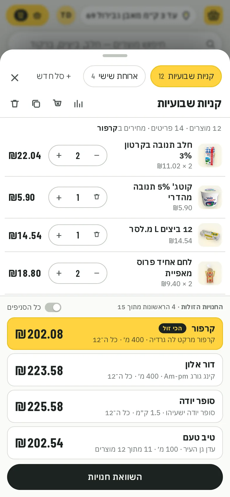

# Sal-Kal · סל קל

**What your cart costs, at every supermarket near you.** Sal-Kal prices a whole shopping cart at every Israeli
supermarket chain within your chosen distance and shows where it costs least. It is free, has no ads, and no retailer
pays for placement. Live at **[sal-kal.com](https://sal-kal.com)**.

<p align="center">
&nbsp;&nbsp;</p>

## Where the prices come from
Section 30 of Israel's [Promotion of Competition in the Food and Pharm Sectors Law, 5774–2014](https://he.wikisource.org/wiki/חוק_קידום_התחרות_בענפי_המזון_והפארם)
requires every large food retailer to publish online the current price of every product, separately for each store,
updated through the day (the Price Transparency Regulations, 5775–2014). Sal-Kal downloads those files with the
open-source [israeli-supermarket-scarpers](https://github.com/OpenIsraeliSupermarkets/israeli-supermarket-scarpers),
indexes them, and counts a price only when it can be confirmed:
- the store's file is current (under 26 hours old);
- it's the same product: a valid manufacturer barcode, named consistently across chains;
- the price is within a sane range of the same product elsewhere;
- a deal counts only when its description and numbers agree.

Anything else is shown greyed out, with the reason, and never counted.

## Features
- Carts you name and keep (weekly shop, Shabbat…), compared at every branch within 1–20 km, with route, drive time and
  opening hours; product-by-product tables and price history.
- Hebrew by default, with a mirrored right-to-left layout, and English.
- Sign in with Google. Your address is picked from the official town and street lists (data.gov.il), never typed free-form.
- Built for phones: bottom sheets, haptics, skeleton loading, install to the home screen.

## Stack
Python 3.12, FastAPI and SQLite (FTS5) on the server. The frontend is vanilla JS with no build step, MapLibre with
OpenFreeMap tiles, Nominatim and OSRM. It runs in a systemd sandbox behind a Cloudflare Tunnel; see `deploy/`.

```bash
python -m venv .venv && .venv/bin/pip install -r requirements.txt
.venv/bin/python tests/make_fixtures.py /tmp/fx/dumps          # synthetic price files in the real formats
BASKET_DB=/tmp/fx/basket.db .venv/bin/python -m app.indexer --dumps /tmp/fx/dumps
BASKET_DB=/tmp/fx/basket.db .venv/bin/uvicorn app.server:app --port 8080
```
Tests: `.venv/bin/python tests/test_<name>.py` for each file in `tests/`.

## Credit
Built by **[Roman Grinevich](https://www.linkedin.com/in/roman-grinevich/)**.
